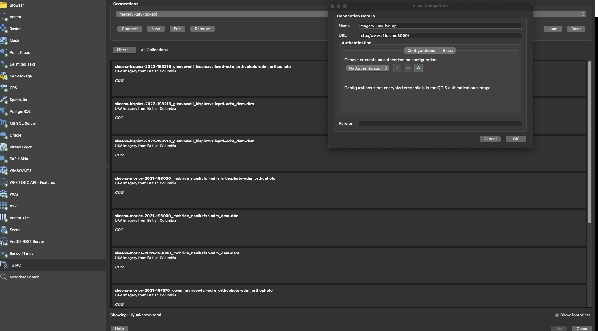

```{r setup, echo=FALSE, include = TRUE}
knitr::opts_chunk$set(echo=TRUE, message=FALSE, warning=FALSE, dpi=60, out.width = "100%")

```


```{r, echo=FALSE, include = T}

staticimports::import()
source('scripts/staticimports.R')
source('scripts/functions.R')
```


```{r build, echo= FALSE, eval = FALSE}
# Render README.md (with rmd_on=FALSE) and index.html (with rmd_on=TRUE)
rmarkdown::render(
  "README.Rmd",
  output_format = "github_document",
  params = list(rmd_on = FALSE, update_query = FALSE)
  )

rmarkdown::render(
  "README.Rmd",
  output_format = "html_document",
  output_file = "index.html",
  params = list(rmd_on = TRUE, update_query = FALSE)
  )

usethis::use_git_ignore("README.html")
```


<!-- README.md is generated from README.Rmd. Please edit that file -->


The goal of [`stac_uav_bc`](https://github.com/NewGraphEnvironment/stac_uav_bc) is to document and serve out UAV imagery collected in British Columbia as a [SpatioTemporal Asset Catalog (STAC)](https://stacspec.org/) collection, organized by region / watershed-group / year. Queryable by location and time (items carry flight capture datetimes) via the [`rstac` R package](https://brazil-data-cube.github.io/rstac/), QGIS (v3.42+), or any STAC-compliant client. The API endpoint is <https://images.a11s.one>; an interactive single-COG viewer lives at <https://viewer.a11s.one>.

The repo also covers the two steps either side of the catalogue: **stitching** flights with OpenDroneMap, and **planning** them. `scripts/flight_plan.py` reads a floodplain delineation from the [`stac-floodplains-bc`](https://github.com/NewGraphEnvironment/stac_floodplains_bc) collection, splits a reach into blocks that each fit one battery, and writes DJI WPML `.kmz` missions — closing the loop, since the imagery those missions produce comes back into this catalogue.

<br>

Sister collections on the same `images.a11s.one` endpoint:

- [`stac_dem_bc`](https://github.com/NewGraphEnvironment/stac_dem_bc) — LidarBC digital elevation models (~58k GeoTIFFs)
- [`stac_airphoto_bc`](https://github.com/NewGraphEnvironment/stac_airphoto_bc) — historic airphoto thumbnails (1963–2019)

To add new imagery to the catalog follow the recipe in [`scripts/config/README.md`](scripts/config/README.md).

<br>


```{r fig, echo=FALSE, out.width="100%", fig.align="center"}
knitr::include_graphics("fig/cover.JPG")
```

## Query the collection

Query the `imagery-uav-bc-prod` collection by bounding box. Below: every UAV item whose footprint intersects the full BC extent.

```{r api1, eval=params$update_query}
# bc bounding box
bcbbox <-  as.numeric(
  sf::st_bbox(bcmaps::bc_bound()) |>
    sf::st_transform(crs = 4326)
)

# use rstac to query the collection
q <- rstac::stac("https://images.a11s.one/") |>
    rstac::stac_search(
      collections = "imagery-uav-bc-prod",
      bbox = bcbbox
    ) |>
  rstac::post_request()

# get details of the items
r <- q |>
  rstac::items_fetch()

saveRDS(r, "data/stac_result.rds")
```


```{r tab-make}

r <- readRDS("data/stac_result.rds")

# build the table to display the info — split the asset URL into region / watershed_group / year / item
url_bucket <- "https://imagery-uav-bc.s3.amazonaws.com/"
tab <- tibble::tibble(url_download = purrr::map_chr(r$features, ~ purrr::pluck(.x, "assets", "image", "href"))) |>
  dplyr::mutate(stub = stringr::str_replace_all(url_download, url_bucket, "")) |>
  tidyr::separate(
    col = stub,
    into = c("region", "watershed_group", "year", "item", "rest"),
    sep = "/",
    extra = "drop"
  ) |>
  dplyr::mutate(
    link_view = dplyr::case_when(
      !tools::file_path_sans_ext(basename(url_download)) %in% c("dsm", "dtm") ~
        ngr::ngr_str_link_url(
          url_base = "https://viewer.a11s.one/?cog=",
          url_resource = url_download,
          url_resource_path = FALSE,
          anchor_text = tools::file_path_sans_ext(basename(url_download))
        ),
      TRUE ~ "-"
    ),
    link_download = ngr::ngr_str_link_url(url_base = url_download, anchor_text = url_download)
  ) |>
  dplyr::select(region, watershed_group, year, item, link_view, link_download)
```

<br>

`r if (params$rmd_on == FALSE) "Please see http://www.newgraphenvironment.com/stac_uav_bc for the published table of collection links and inline viewer links."`


```{r tab-uav-imagery-cap, echo=FALSE, results="asis", eval=identical(params$rmd_on, TRUE)}
my_caption <- "Drone imagery download and viewer links."

my_tab_caption_rmd()
```


```{r tab-uav-imagery, echo=FALSE, eval=identical(params$rmd_on, TRUE)}
tab |>
  my_dt_table(cols_freeze_left = 2, escape = FALSE)
```

## Item properties

Beside `datetime`, `title` and the `proj:` fields, each item carries its site's row from [`data/sites.csv`](data/sites.csv). Each field's prefix says what it describes ([#38](https://github.com/NewGraphEnvironment/stac_uav_bc/issues/38)). A blank registry cell is left off the item rather than written empty.

| field | holds | from |
|---|---|---|
| `newgraph:region` | New Graph's region (`skeena`, `fraser`, `mackenzie`, `kootenay`), also the first part of the item id | registry |
| `uav:stream_name` | the stream the flight covers | registry, picked from PSCIS, bcfishpass or the Freshwater Atlas (`name_source` says which) |
| `uav:stream_name_02`, `uav:stream_name_03` | further streams in the same flight | registry |
| `fwa:watershed_group_code` | the Freshwater Atlas watershed group code (`MORR`) | registry |
| `fwa:watershed_group_name` | the atlas's name for that group (`Morice River`) | atlas, by code (`scripts/sites_fill-wsg_name.py`) |
| `bcfishpass:aggregated_crossings_id` | the crossing the flight covers | bcfishpass |
| `newgraph:alias` | New Graph's name for the site, which separates repeat flights in the title (`moose pre-replacement`) | registry |
| `newgraph:project` | New Graph's project | registry (none set yet) |
| `alignment:*` | the dataset's fit to the LidarBC 1 m DEM: shift, offset, tilt, misfit (see [Elevations](#elevations)) | `data/alignment_lidarbc.csv`, by `scripts/dataset_align-lidarbc.py` |

They replace the `nge:` fields (`nge:stream_name`, `nge:wsg_code` and the rest) that items carried until the release that ships #38, whose `NEWS.md` entry lists each old and new name. Filter on any of them with CQL2, for example every item in the Morice watershed group:

```{r filter, eval=FALSE}
rstac::stac("https://images.a11s.one/") |>
  rstac::stac_search(collections = "imagery-uav-bc-prod", limit = 1000) |>
  rstac::ext_filter(`fwa:watershed_group_code` == "MORR") |>
  rstac::post_request()
```

## Elevations

UAV elevations in this catalogue are GPS-referenced. No flight used ground control, so each DTM and DSM sits where the drone's own GPS placed it, and so does the orthophoto. Measured against the LidarBC 1 m DEM over the 46 datasets that have one under them and could be fitted, the published rasters sit a median of 8.3 m from LidarBC vertically (from −97 to +92 m) and 3.2 m horizontally (up to 12.4 m). The geoid (−8 to −15 m here) does not explain it; the drone's altitude does. The measurements are in [`research/uav_pointclouds.md`](research/uav_pointclouds.md).

The rasters are published as they are. Instead, every item of a dataset on LidarBC carries the dataset's fit as `alignment:` fields: a horizontal shift and a quadratic correction surface (vertical offset, tilt and curvature, the doming a GPS-only photogrammetric block has), fitted to LidarBC ground by [`scripts/dataset_align-lidarbc.py`](scripts/dataset_align-lidarbc.py), one row per dataset in [`data/alignment_lidarbc.csv`](data/alignment_lidarbc.csv). After the fit, the ground misfits LidarBC by a median of 0.42 m (NMAD over the ground points compared): 42 of 46 datasets within 1 m, 26 within 0.5 m. The 31 datasets with no LidarBC under them (mostly the Morice 2021–2026 and the upper Parsnip 2022–2024) , the 3 whose fit could not be determined (a flat site gives the shift no signal; a flight the DEM covers only partly) and the 3 with no ODM point cloud (two orthophoto-only datasets and one duplicate flight) carry no fields.

`alignment:applied` is `false` on every item that carries the fields: the rasters are published as ODM wrote them, and the fields are there to be applied. [#46](https://github.com/NewGraphEnvironment/stac_uav_bc/issues/46) publishes them corrected and sets it `true`, and the fields then record what was applied.

To apply a fit, in the item's own CRS (`proj:epsg`):

- corrected (x, y) = published (x, y) + (`alignment:shift_x_m`, `alignment:shift_y_m`)
- corrected z = published z − s(u, v), where u = (x − cx) / 100 and v = (y − cy) / 100 with (cx, cy) = `alignment:centre`, and s = a + b·u + c·v + d·u² + e·u·v + f·v² with [a, b, c, d, e, f] = `alignment:surface` (`alignment:model` is `quadratic`; a `plane` row would carry [a, b, c] alone)

LidarBC is NAD83(CSRS) UTM and the items are WGS 84 UTM. The fit went through PROJ's default transformation between the two, so the corrected coordinates land on LidarBC when reprojected the way QGIS, GDAL and R do by default.

| field | holds |
|---|---|
| `alignment:reference` | the LidarBC delivery the fit used (`093/093g/2024`, collection `stac-elevation-bc`); two deliveries `;`-joined where the flight spans them |
| `alignment:shift_x_m`, `alignment:shift_y_m` | the horizontal shift, m, in the item's CRS |
| `alignment:offset_m` | the vertical correction at the dataset's centre, m |
| `alignment:tilt_m_per_100m` | the magnitude of the tilt |
| `alignment:surface`, `alignment:centre` | the fitted coefficients, per 100 m, and the point they are about |
| `alignment:misfit_m` | NMAD of the residual over the ground points compared, m |
| `alignment:points` | ground points compared |
| `alignment:model` | `quadratic` (chosen over a plane by the trial in [`research/uav_pointclouds.md`](research/uav_pointclouds.md)) or `plane` |
| `alignment:applied` | `false`: the raster is as ODM wrote it, apply the fields; `true` (after #46): the fit was applied to the published raster |

The fields are numbers, so they filter. Every dataset that fits LidarBC within a metre:

```{r filter-alignment, eval=FALSE}
rstac::stac("https://images.a11s.one/") |>
  rstac::stac_search(collections = "imagery-uav-bc-prod", limit = 1000) |>
  rstac::ext_filter(`alignment:misfit_m` < 1) |>
  rstac::post_request()
```

## QGIS Data Source Manager (v3.42+)

QGIS 3.42 added native STAC support — connect directly to the catalog and filter by the current map view. See [Lutra Consulting's STAC-in-QGIS blog post](https://www.lutraconsulting.co.uk/blogs/stac-in-qgis) for a walk-through.

```{r echo=FALSE, fig.cap="Connecting to https://images.a11s.one"}

```

```{r echo=FALSE, fig.cap="Using the field of view in QGIS to filter results"}
knitr::include_graphics("fig/a11sone02.png")
```

## Build pipeline

Collection, item, and catalogue creation are documented in three Quarto notebooks:

- [`stac_create_catalouge.qmd`](stac_create_catalouge.qmd) — root catalogue assembly
- [`stac_create_collection.qmd`](stac_create_collection.qmd) — collection-level metadata
- [`stac_create_item.qmd`](stac_create_item.qmd) — per-item assembly

The `scripts/` directory holds the orchestration helpers:

| Script | Role |
|---|---|
| `cog_convert.R` | Convert ODM-output GeoTIFFs to Cloud-Optimized GeoTIFFs |
| `odm_process.R` | OpenDroneMap processing (orthomosaic, DSM, DTM generation) |
| `s3_sync.R` | Sync COGs to the `imagery-uav-bc` S3 bucket |
| `s3_index.R`, `s3_map.R` | Index + map S3 contents for ingestion |
| `item_create.py` | Create STAC items + update collection.json: additive for new COGs, `--rebuild` for every item, `--selftest` as its gate |
| `web.R` | Web/viewer utilities |
| `stacs.sh` | The pinned [`stacs`](https://github.com/NewGraphEnvironment/stacs) CLI — registers and verifies the catalogue against `stacs.toml` |
| `config/` | Server docs + `item_unregister.sh` (the delete path; stacs is upsert-only) — see the [add-imagery recipe](scripts/config/README.md) |
| `viewer.html` | Standalone viewer-page template for single-COG previews |

Recent infrastructure work — see commit history — added client-side pagination handling (so very large queries return correctly via successive `items_next()` fetches) and split S3 uploads into 1000-item chunks for memory safety.

## Roadmap

- **UAV-specific QGIS symbology** ([#5](https://github.com/NewGraphEnvironment/stac_uav_bc/issues/5)) — default styling that distinguishes orthomosaic vs DSM vs DTM at a glance.
- **Methods section in README** ([#4](https://github.com/NewGraphEnvironment/stac_uav_bc/issues/4)) — document the ODM → COG → STAC pipeline end-to-end with the parameters that matter (GSD, projection, compression).
- **`stac/` directory cleanup** ([#11](https://github.com/NewGraphEnvironment/stac_uav_bc/issues/11)) — detect + remove STAC item directories that no longer correspond to a source mission.

Browse [open issues](https://github.com/NewGraphEnvironment/stac_uav_bc/issues) for the full backlog.

## License

[MIT](LICENSE).
