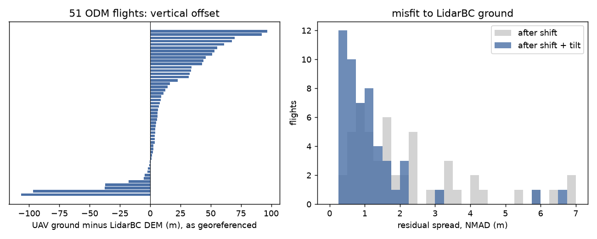
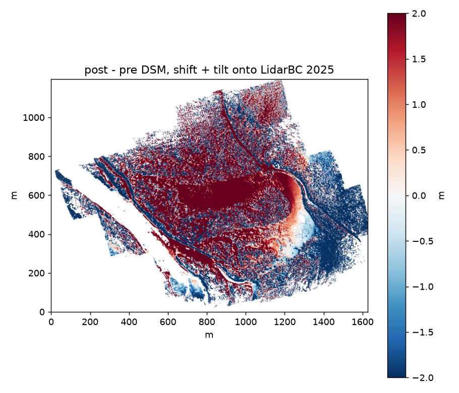
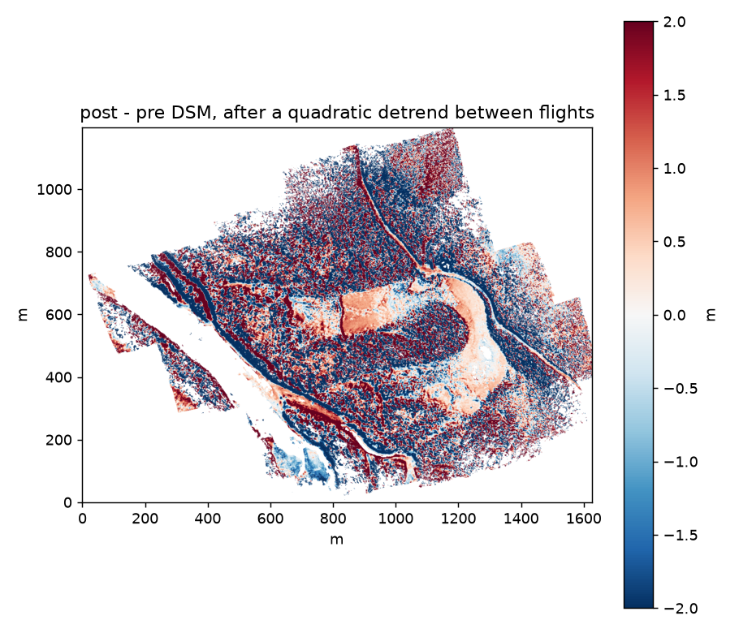

# UAV point clouds: what we have, how far off they sit, and where the value is

**Verified:** 2026-10-16 · **Issues:** spawned #41 (alignment; built, see "Alignment in the
pipeline"), #42 (COPC publishing), #43 (change detection); added in #44 · **Produced by:** the probes
in [`uav_pointclouds/`](uav_pointclouds/) (each says what it reads), run over the raw imagery tree;
per-flight numbers in [`uav_pointclouds/uav_lidarbc_offsets.csv`](uav_pointclouds/uav_lidarbc_offsets.csv);
the pipeline's own fits in [`../data/alignment_lidarbc.csv`](../data/alignment_lidarbc.csv) and its
model × mask trial in [`uav_pointclouds/trials/grid.csv`](uav_pointclouds/trials/grid.csv), both
written by `scripts/dataset_align-lidarbc.py`

The question was whether our UAV point clouds are worth putting in a STAC, whether they line up with
LidarBC, and whether any of it supports change-over-time analysis. Short answers: the clouds are cheap
to publish but are not where the value starts; they do **not** line up with LidarBC as they stand, and
neither do the DTMs and DSMs already in this catalogue; a simple fit against LidarBC brings about half
of them within a metre, which is enough for large changes and not for small ones.

## What we have

| | ODM (`odm_georeferencing/odm_georeferenced_model.laz`) | Maps Made Easy (`mme/*.las`) |
|---|---|---|
| files | 83, one per processed flight (4 more are `--split` submodels) | 15, older flights processed outside ODM |
| format | LAS 1.2, point format 3, RGB | LAS 1.2, point format 2, RGB |
| classes | 1, 2, 3, 6 (ODM's own classifier; one file has class 1 only) | none (all class 0) |
| density, points over bbox area | median 52 pts/m², 2.5–256 | median 96 pts/m², 42–441 |
| CRS | WGS 84 / UTM 9N, 10N, 11N; **no vertical CRS** | same |

About 12 GB and 1.3 billion points in all. ODM runs at `--pc-quality low` (`odm_process-batch.sh`).
**No flight used ground control**: all 80 `odm_report/stats.json` report `has_gcp: false`, and no
`gcp_list.txt` exists in the tree, so each cloud is placed by the drone's own GPS. Photogrammetry gives
one surface per point, so nothing sees under canopy; in dense forest ODM's class 2 can only be the
lowest surface the cameras saw.

52 of the 83 ODM clouds, and 9 of the 15 Maps Made Easy clouds, fall on a LidarBC 1 m DEM (searched by
bounding box in `stac-elevation-bc`). The 31 that do not are mostly in the Morice (all of 2021, 2023
and the 2026 Wedzin Kwa reaches) and the upper Parsnip (2022–2024).

## How far off they sit

For each cloud on a LidarBC DEM (the newest delivery under it), ground points were compared with the
DEM (`uav_lidar_align.py`). The model is the cheapest one that could explain a GPS-only
reconstruction: a horizontal shift, a vertical offset and a tilt, fitted robustly.

51 ODM flights with classified ground:

| | median | middle half | range |
|---|---|---|---|
| vertical offset, as georeferenced | +6.3 m | +1.9 to +33 m | **−107 to +97 m** |
| horizontal shift that fits best | 3.5 m | 1.9–5.8 m | 0–19 m |
| tilt | 1.2 m per 100 m | 0.45–2.4 | 0–7.2 |
| misfit (NMAD), shift only | 1.6 m | 0.94–2.9 | 0.46–15 |
| misfit (NMAD), shift + tilt | **0.82 m** | 0.52–1.4 | 0.34–6.7 |

- **The vertical offsets are not a datum problem.** The geoid separation at these sites is −8 to −15 m
  (CGG2013a), while the offsets run past ±100 m and differ between flights of the same reach. They are
  the drone's GPS altitude, which ODM takes as given.
- **The published DTMs and DSMs carry the same offsets.** Sampled at 20,000 ground points each,
  `odm_dem/dtm.tif` on the bucket matches its cloud to 0.00 m at `195290_gibson_hwy16` (cloud −37 m
  from LidarBC) and `bulkley_bul38` (+46 m). Anyone reading an elevation off one of our UAV DTMs is
  reading a number that is off by a median of 9 m.
- **After shift + tilt, 29 of 51 flights fit within 1 m and 12 within 0.5 m.** The misfit is an upper
  bound on the alignment error: it also holds real change since the LiDAR (flown 2018–2025, the UAV
  2020–2026) and vegetation that ODM classed as ground. Six flights stay above 2 m: the three 2026
  flights over a kilometre long in the Parsnip and upper Peace, at under 9 pts/m², and three 2025
  flights in the Bulkley.
- The Maps Made Easy clouds fit worse (median 3.3 m) only because they are unclassified, so the
  comparison includes vegetation. 13 of the 15 sit in a dataset directory ODM also processed, and the
  two placements differ by up to 51 m vertically (`195290_gibson_hwy16`: ODM −37 m, Maps Made Easy
  +14 m).

## Change over time: one pair, tested

The only UAV-to-UAV pair flown close together is the Parsnip crossing `199663` ("moose"), flown
2026-07-14 before its replacement and 2026-09-15 after, with LidarBC 2025 under both
(`moose_change.py`, `moose_detrend.py`; 0.5 m DSMs from the clouds).

| post minus pre | median | 5th–95th percentile |
|---|---|---|
| as georeferenced | +49 m | +25 to +71 m |
| each flight fitted to LidarBC (shift + tilt) | +0.5 m | −8.6 to +7.7 m |

Fitted to LidarBC, the difference is still a **bowl**: centre up, edges down, about 12 m across 1.6 km.
That is the doming a GPS-only, nadir-only photogrammetric block is known for, and no rigid model
removes it. The post flight alone was tilted 4.4 m per 100 m, and its horizontal shift is not well
determined: two fits on different point samples gave 18.8/8.0 m and 16.5/9.3 m. A robust quadratic fitted to the
difference itself takes most of the bowl out:

What is left: open ground is smooth to about ±0.5 m, forest is ±2 m noise (crowns seen from slightly
different positions), and every road and bank shows a paired red/blue edge, which is 1–2 m of
horizontal misregistration. The residual misfit is 2.5 m NMAD. **Culvert-scale change (a metre or two
over a few tens of metres) cannot be separated from that with these flights.**

## Where the value is

Ranked by value for the effort, cheapest first.

1. **Fix the absolute elevations we already publish.** Every UAV DTM and DSM in `imagery-uav-bc-prod`
   is off by the flight's GPS error. Measuring each flight's shift + tilt against LidarBC is a script
   that already runs (here, 15 minutes for 61 clouds), and recording it on the items, or publishing
   corrected rasters, turns a misleading elevation into a useful one for the 29 flights that fit
   within a metre. The 31 off LidarBC need another reference or ground control.
2. **LiDAR then UAV, where the change is large.** Every flight on LidarBC is already a two-epoch pair:
   the LiDAR (2018–2019 in the Bulkley, 2024–2025 in the Fraser and Parsnip) and the UAV years later.
   With about 0.8 m misfit after alignment, changes of 2 m or more on open ground are measurable: bank
   retreat, channel migration across gravel bars, wood jams, fill at a crossing. This needs one test
   on a reach where something moved before it is worth building.
3. **Publish the clouds as COPC.** Low effort (83 files, 4.8 GB) and useful to look at in 3D, and it
   makes 1 and 2 reproducible from the catalogue. On its own it adds little analysis: the clouds are
   low-density, single-return and, until 1 is done, in the wrong place.
4. **UAV to UAV change: not with the flights we have.** The moose pair shows the limit: metres of
   relative error that a smooth model only partly removes. It needs either ground control (a few
   checkerboards surveyed with a GNSS receiver) or an RTK/PPK drone, which would put each flight within
   centimetres without any of the fitting above. That is a field decision, not a processing one.

## Alignment in the pipeline (#41)

`scripts/dataset_align-lidarbc.py` promotes `uav_lidar_align.py`. For every published dataset it fits
the ODM ground (class 2) to the newest LidarBC delivery that covers at least half the flight, writes
one row to `data/alignment_lidarbc.csv`, and `item_create.py` carries a fitted row on every item of the
dataset as `alignment:` fields (the README's "Elevations" section says how to apply them). The rasters
are published as they are, and `alignment:applied` says so (`false`); #46 publishes them corrected and
flips it, and #42 then publishes the clouds the same way. What changed from the probe, and why:

- **Bilinear DEM sampling.** Nearest-cell added slope × U(−0.5, 0.5) m per point and made the
  0.25 m search a step function.
- **A Huber fit** (k = 1.345 robust scales) in place of least squares with a 3-NMAD trim, so the
  fitter and the score (NMAD) share a loss; ten rows of the table above got worse from shift-only to
  shift + tilt under the trimmed fit.
- **The shift searched twice**, on two disjoint 20 000-point samples, which must agree within 2 m:
  a flat site gives the shift no signal, and the probe's single search returned a number there all
  the same. The cut was set from the plane run, where the 47 that fit agree within 1 m (41) or
  1.3 m (four) and the next two sit at 5.5 m (`maxan_mx1`) and 8.5 m (the moose pre flight). The
  quadratic table (the one shipped) is not as cleanly split: the quadratic fits both of those (spreads
  0.5 and 0.8 m), its largest fitted spread is 1.95 m (`richfield_lower_RC3`, the one dataset it fits
  worse than the plane) and its refusals sit at 2.6 m (`197912_roberthatch`) and 5.6 m.
- **Coverage.** A delivery covering under half the flight is refused, after trying the older ones:
  `16701523_table_ck` (27 %) is refused where the probe fitted it on a sliver.
- **The dataset's own DTM checked** against its cloud (median within 0.1 m over 2000 ground points)
  before fitting, since the DTM is what carries the fields.
- **No geoid term.** It never entered the fit, and without the grid PROJ returns 0 silently.
- **No held-out split.** One was built and dropped: fitting on one half of a 50 m checkerboard and
  scoring on the other biased the search, because both "independent" samples then came from the same
  half of the ground (`8530_sandstone_mcdonell`: 0.56 m on the fit's own sample, 2.65 m on every
  point, at a shift 9 m from the probe's). A random split tests nothing at 10⁵ points and 3 or 6
  parameters. The misfit is the NMAD over every ground point compared, as in the table above.

**Result (2026-10-16).** Of the 83 published datasets, 46 fit (the quadratic, no mask: the trial
below), 31 have no LidarBC under them, 3 have no ODM cloud, 3 are refused (`197912_roberthatch` and
the moose post flight `shift_unstable`, their two shift searches 2.6 and 5.6 m apart;
`16701523_table_ck` `low_coverage`, 27 %). Misfit of the fitted: median **0.42 m** (quartiles
0.32–0.69), 42 within 1 m, 26 within 0.5 m. Fitted as a plane, the pipeline reproduces the table
above on the same datasets: median 0.82 → 0.79 m, the same 28 within 1 m and 12 within 0.5 m, the
per-dataset misfits within 0.18 m and the raw offsets within 0.03 m. Shifts agree to ±0.4 m for the
middle half; nine differ by more than 1 m, all on near-flat score valleys (below).

**Trial of models and masks.** `--trial` fits every model × mask on each dataset in one pass: the
same cloud, reference and search samples, and every arm scored on every ground point compared, so a
mask is judged on the ground it dropped as well as the ground it kept. `plane` or `quadratic`
(u², uv, v² added); `none`, `slope` (LidarBC ground steeper than 15° left out of the fit), `open`
(the dataset's own DSM − DTM over 0.5 m, canopy, left out), `slope+open`. The DSM and DTM are each
sampled on their own grid: on 16 published datasets the two are a column, or a centimetre of origin,
apart, and a first pass that demanded one grid refused them.

| model | mask | fitted | misfit, median (quartiles) | ≤ 1 m | ≤ 0.5 m | paired with plane/none | lower / of |
|---|---|---|---|---|---|---|---|
| plane | none | 45 | 0.79 (0.47–1.17) | 27 | 12 | – | – |
| plane | slope | 40 | 0.76 (0.46–1.25) | 25 | 11 | +0.010 m | 10 / 40 |
| plane | open | 43 | 0.76 (0.45–1.17) | 27 | 12 | +0.000 m | 19 / 42 |
| plane | slope+open | 34 | 0.57 (0.42–0.97) | 26 | 12 | +0.002 m | 15 / 34 |
| quadratic | none | 46 | **0.42** (0.32–0.69) | 42 | 26 | −0.225 m | 42 / 44 |
| quadratic | slope | 44 | 0.41 (0.28–0.70) | 40 | 25 | −0.228 m | 36 / 42 |
| quadratic | open | 47 | 0.40 (0.29–0.67) | 43 | 30 | −0.237 m | 44 / 45 |
| quadratic | slope+open | 46 | 0.41 (0.28–0.66) | 42 | 28 | −0.224 m | 41 / 45 |

Misfit in metres (NMAD over every ground point compared) over the datasets the arm fitted; the
paired columns are the median per-dataset difference from plane/none over the datasets both fitted,
and on how many of them the arm is lower. Every refusal is `shift_unstable`: a mask thins the two
search samples, and the plane's slope+open arm loses 14 datasets that way. The re-run of 16 datasets
(below) reproduced the first pass cell for cell, the per-dataset random state being fixed.

**Verdict: the quadratic, no mask.** The quadratic lowers the plane's misfit on 42 of the 44 datasets
both fit, by a median of 0.225 m (0.78 → 0.42 m), and is worse only on `richfield_lower_RC3`
(0.53 → 0.85 m); within 1 m goes from 27 datasets to 41, within 0.5 m from 12 to 25. The doming
the moose pair showed is general: Pedley's correction surface bends by 2 m at 100 m from its centre
in both directions. Within the quadratic the masks are a tie. Paired against no mask, `slope` moves
the median by 0.000 m (lower on 19 of 42), `open` by −0.006 m (lower on 34 of 46; one dataset better
by over 0.1 m, none worse) and `slope+open` by −0.006 m (27 of 45). What a mask buys is one dataset:
`197912_roberthatch`, whose two shift searches disagree by 2.6 m on all its ground and agree on the
open ground alone (`open` fits it at 0.15 m), is refused in the table. By the rule set at the plan
gate (lowest median misfit over the same points, ties to the simpler) the default is `--model
quadratic --mask none`; `--mask open` stays available and costs only the dataset's own DSM and DTM.

**Limits.**

- A site with one linear feature (a road, a bank) determines the shift across the feature, not along
  it, and the two-sample test sees sampling noise, not that ambiguity: `8530_sandstone_mcdonell`
  scores 1.63 m at (−0.4, 4.9) and 1.68 m at (7, −1). The misfit reports the fit; the shift's
  uncertainty along such a feature is not recorded.
- The 2019 LidarBC tiles carry no vertical CRS (2024 and later are CGVD2013); the fit takes the tiles
  as they are.
- A GPS-only scale error is representable by neither model.

## What is not known yet

- How much of each flight's misfit is real change since the LiDAR rather than alignment error. The
  `open` and `slope` masks above split out canopy and steep ground, not change on open ground.
- Whether `--pc-quality medium` or `high` changes any of this. It would raise density, not fix
  placement.
